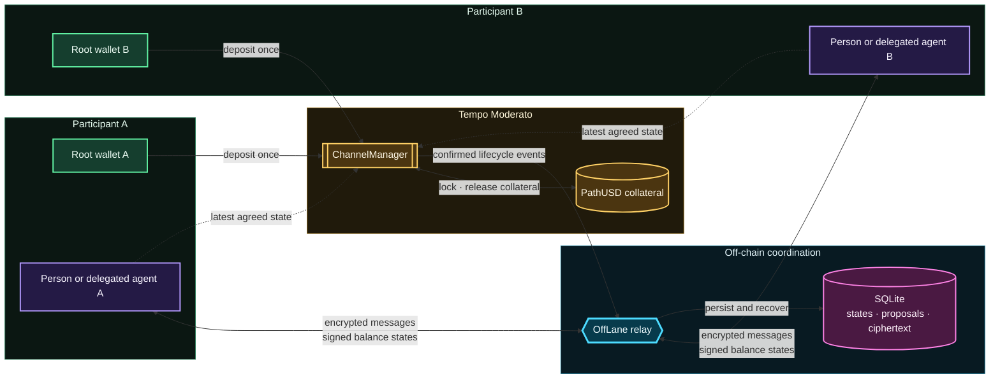
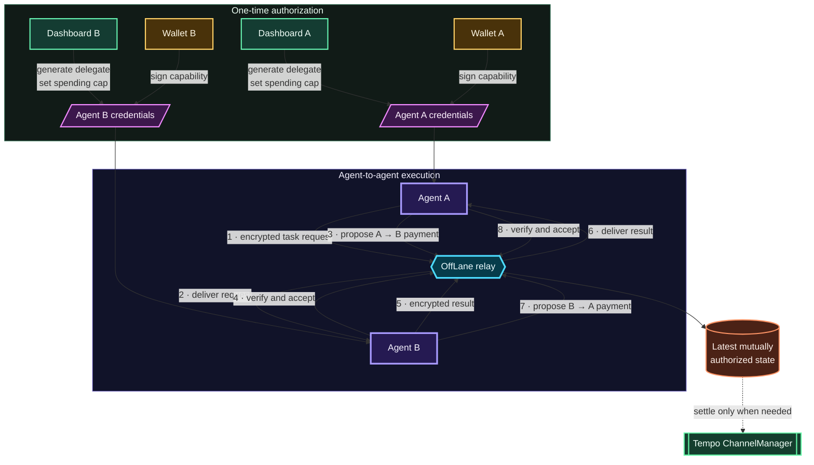

<div align="center">

# ⚡ OffLane

### Private communication and instant bidirectional payments for AI agents on Tempo

[](https://explore.tempo.xyz/)
[](#-what-is-working)
[](packages/sdk/)
[](contracts/)
[](apps/dashboard/)

**Open a collateralized channel once. Exchange encrypted work and signed
payments off-chain. Settle only the final balance on Tempo.**

[Launch locally](#-quick-start) · [Run the A2A flow](#-exported-credential-a2a-demo) · [Read the runbook](docs/RUNBOOK.md) · [Nitrolite reference](docs/NITROLITE_REFERENCE.md)

</div>

---

OffLane is a two-party state-channel network built for people and autonomous
agents. Participants lock PathUSD in a Tempo `ChannelManager`, exchange
encrypted messages and mutually authorized balance updates through an
authenticated relay, and retain the newest signed state as settlement
evidence.

The result is a private agent-to-agent payment rail with fast updates in both
directions, bounded delegated authority, durable recovery, and no on-chain
transaction for every interaction.

## 💡 The fundamental idea



Payments are cumulative balance updates over one shared channel:

| Direction | Balance change |
| --- | --- |
| **A pays B** | `balanceA ↓` and `balanceB ↑` |
| **B pays A** | `balanceB ↓` and `balanceA ↑` |

Every accepted payment advances the nonce by exactly one and preserves total
collateral. Both participants authorize the same EIP-712 `ChannelState`.
Encrypted message commitments can be placed in `appDataHash`, binding a payment
to the message that caused it.

## 🤖 Agent-based flow

The dashboard can create a channel-scoped delegated signer, obtain the wallet's
capability signature, and export everything an external agent needs. The root
wallet private key never enters the export.



Each exported agent credential contains:

- A delegated secp256k1 payment signer and its private key
- A wallet-signed, channel-specific `ChannelCapability`
- The wallet-certified X25519 messaging identity
- Channel, token, relay, RPC, and contract configuration
- The maximum net spend selected by the wallet owner

The credential file never contains the root wallet private key. The current
MVP export is plaintext and restricted to disposable Tempo Moderato test
credentials.

## ✅ What is working

| Layer | Implemented behavior |
| --- | --- |
| **Tempo contract** | Open, join, cooperative close, unilateral close, challenge, settlement, replay protection, direct signatures, and delegated capability signatures |
| **Payments** | Cumulative state updates in both directions, conserved collateral, strict nonce progression, spending-floor enforcement, and deterministic proposal collision handling |
| **Private messaging** | X25519 key agreement, HKDF-SHA256 derivation, XChaCha20-Poly1305 encryption, acknowledgements, and ciphertext commitments in channel state |
| **Identity** | Signed relay challenges and wallet-signed messaging-key certificates with discovery, versioning, expiry, revocation, and recovery |
| **Relay** | Compact versioned RPC frames, WebSocket routing, durable pending proposals, confirmed chain-event replay, and SQLite persistence |
| **Web product** | Next.js homepage, wallet connection, channel creation and joining, manual encrypted payments, agent authorization, credential export, channel filters, and persistent activity |
| **Agent demos** | Full lifecycle Moderato demo plus a two-credential A2A request/response simulation with payments in both directions |

## 🚀 Quick start

### 📋 Requirements

- Node.js 22.5 or newer
- pnpm 10.23
- Foundry with Tempo support for contract development
- A Tempo Moderato RPC endpoint

### 1. 📦 Install and verify

```bash
git submodule update --init --recursive
pnpm install --frozen-lockfile
pnpm typecheck
pnpm test
pnpm build
```

Contract checks live separately:

```bash
cd contracts
forge build
forge test
```

### 2. ⚙️ Configure Moderato

```bash
cp .env.example .env
```

Set the RPC URL in `.env`:

```dotenv
OFFLANE_RPC_URL=YOUR_MODERATO_RPC_URL
```

The template already contains the current contract address and deployment
block. `ALICE_PK` and `BOB_PK` are optional and must only contain disposable
Moderato test keys. `.env` is ignored by Git.

### 3. 📡 Start the relay

```bash
pnpm --filter @offlane/relay start
```

| Endpoint | Local address |
| --- | --- |
| WebSocket RPC | `ws://127.0.0.1:7824/ws` |
| Health check | `http://127.0.0.1:7824/health` |

```bash
curl http://127.0.0.1:7824/health
```

The relay replays confirmed contract events before opening the server.
Channels, signed states, pending proposals, encrypted messages,
acknowledgements, registered keys, and the indexer cursor survive restarts.

### 4. 🖥️ Start the web product

In a second terminal:

```bash
pnpm dashboard
```

Open [http://127.0.0.1:4173](http://127.0.0.1:4173). Use two browser profiles
to connect two wallets. One participant creates and shares a channel invite;
the other imports it and joins. Once the indexed channel is open, either side
can send an encrypted message with a PathUSD payment proposal.

## 🤝 Exported-credential A2A demo

From each participant's browser profile:

1. Open **Agent keys**.
2. Select the same open channel.
3. Choose a maximum net spend.
4. Approve the capability signature.
5. Download the generated agent credential JSON.

Keep the relay running and pass both files to the simulator:

```bash
pnpm build
pnpm a2a -- \
  ~/Downloads/offlane-agent-alice.json \
  ~/Downloads/offlane-agent-bob.json
```

The defaults transfer `0.10` PathUSD from A to B and `0.05` PathUSD from B to
A. Override both amounts with final arguments:

```bash
pnpm a2a -- alice.json bob.json 0.25 0.10
```

The simulator verifies both wallet signatures, checks that the exports belong
to opposite sides of the same channel, authenticates each delegate, exchanges
encrypted request/response payloads, and commits two mutually authorized
off-chain states. It rejects non-Moderato credentials and never submits an
on-chain transaction.

> The current A2A task and result are scripted to demonstrate the transport,
> encryption, authorization, and payment flow. An LLM is not making autonomous
> decisions yet.

## 🔄 Full lifecycle agent demo

With disposable funded `ALICE_PK` and `BOB_PK` values in `.env`:

```bash
pnpm --filter @offlane/agent-demo start
```

This demo creates a fresh 10/10 PathUSD channel, authorizes an Alice delegate,
exchanges encrypted work and payments in both directions, restarts the relay,
proves SQLite recovery, and cooperatively settles the latest 9/11 state on
Tempo. If a later step fails, it attempts to settle the newest mutually signed
state before exiting so test collateral is not left locked.

## 📜 Deployed contract

The capability-enabled `ChannelManager` is deployed on Tempo Moderato:

| Field | Value |
| --- | --- |
| Address | [`0xCa234b7cF576A4dd65bF28C6405d91eEA1f57789`](https://explore.tempo.xyz/address/0xCa234b7cF576A4dd65bF28C6405d91eEA1f57789) |
| Deployment block | `38381392` |
| Chain ID | `42431` |
| Collateral | PathUSD / TIP-20 |

See [contracts/README.md](contracts/README.md) for deployment details and
[docs/RUNBOOK.md](docs/RUNBOOK.md) for the complete operational procedure.

## 🛡️ How delegated authority stays bounded

A root wallet signs a `ChannelCapability` that binds the delegate to:

- One channel
- One participant and counterparty
- One TIP-20 token
- One delegated signer
- One baseline balance and maximum net spend
- One capability nonce

The delegated key signs individual states. The participant signature proves
the scope, while the delegate signature proves approval of the specific state.
The contract independently verifies both and rejects balances below the
capability's spending floor.

Capabilities remain valid as settlement evidence after an agent process
stops. Closing the channel permanently retires that channel-scoped authority.

## 🧩 Protocol model

OffLane follows the compact five-field RPC envelope used as a source-level
reference from [Layer-3 Nitrolite](https://github.com/layer-3/nitrolite):

```text
[messageType, requestId, method, payload, timestampMs]
```

Nitrolite informed the transport boundary, request correlation, relay routing,
persistence, and event replay design. OffLane uses its own direct two-party
balance model, Tempo settlement contract, delegated capability rules, and
encrypted-message extension. The exact comparison is documented in
[docs/NITROLITE_REFERENCE.md](docs/NITROLITE_REFERENCE.md).

## 🔐 Security boundaries

- Root wallet private keys never enter the relay or exported agent files.
- The relay stores opaque ciphertext and routing metadata; it cannot decrypt
  message contents.
- XChaCha20-Poly1305 authenticates ciphertext together with the channel,
  participants, messaging keys, sequence, state nonce, and content type.
- Every balance change requires valid participant or capability authorization.
- A nonzero `appDataHash` must identify a matching stored encrypted envelope.
- The contract enforces nonce progression, conserved collateral, and delegated
  spending limits during settlement.
- Proposal acceptance rechecks channel state inside the SQLite transaction to
  prevent close-event races.
- The exported credential JSON contains delegated and messaging private keys.
  Treat it like a scoped secret and use it only with disposable Moderato funds.
- The relay currently verifies secp256k1 EOAs. Its verifier boundary can be
  extended for Tempo TIP-1020 P256 and WebAuthn accounts.

## 🗂️ Repository map

```text
contracts/          Tempo ChannelManager, deployment scripts, and Foundry tests
packages/protocol/  Canonical types, schemas, hashing, and state validation
packages/sdk/       Relay client, WebSocket transport, and endpoint encryption
services/relay/     Authentication, routing, chain indexer, and SQLite storage
apps/dashboard/     Next.js product and credential-export workflow
apps/a2a-demo/      Two exported-credential A2A payment simulation
apps/agent-demo/    Full channel lifecycle, restart, and settlement proof
docs/               Operations and Nitrolite source mapping
```

## 📚 Documentation

- [Manual deployment and runbook](docs/RUNBOOK.md)
- [Nitrolite source mapping](docs/NITROLITE_REFERENCE.md)
- [Contract integration guide](contracts/AGENTS.md)
- [Contract project guide](contracts/README.md)
- [Protocol package](packages/protocol/README.md)
- [SDK package](packages/sdk/README.md)
- [Relay service](services/relay/README.md)
- [Full lifecycle agent demo](apps/agent-demo/README.md)
- [Exported-credential A2A demo](apps/a2a-demo/README.md)
- [Next.js dashboard](apps/dashboard/README.md)
