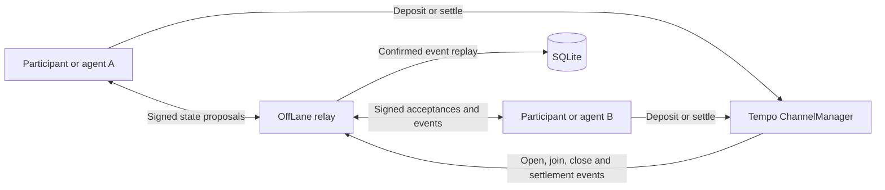

# OffLane

OffLane is a bidirectional off-chain payment network for Tempo, designed for
autonomous AI agents and an encrypted messaging layer. Two participants lock
TIP-20 collateral in `ChannelManager`, exchange signed balance states through
a relay, and settle the latest mutually authorized state on-chain.

The architecture uses Layer-3's
[Nitrolite](https://github.com/layer-3/nitrolite) as a source-level reference
for compact RPC frames, transport separation, request correlation, relay
routing, persistence, and confirmed event replay. OffLane keeps a direct
two-party balance model and Tempo-specific settlement and capability rules.
See [the reference map](docs/NITROLITE_REFERENCE.md) for the exact comparison.

## How it works



Payments are cumulative balance updates. Either participant can pay over the
same channel:

```text
A pays B: balanceA decreases, balanceB increases
B pays A: balanceB decreases, balanceA increases
```

Every accepted update advances the nonce by one and preserves total
collateral. Both participants sign the same EIP-712 `ChannelState`.

## AI-agent authorization

A participant can authorize an automated key with a root-signed
`ChannelCapability`. The capability binds the agent to:

- One channel
- One participant and counterparty
- One TIP-20 token
- A delegated signer
- A baseline balance and maximum net spend
- A capability nonce

The agent signs individual states, while the participant signs the capability.
The contract independently verifies both signatures and enforces the spending
floor. Alice and Bob can each use their own agent in the same bidirectional
channel.

Capabilities deliberately remain valid as settlement evidence after an agent
is stopped. Closing the channel permanently retires that channel-scoped
authority.

## Implemented

- Tempo `ChannelManager` contract with open, join, cooperative close,
  unilateral close, challenge, and settlement paths
- Permanent channel-intent replay protection
- Bidirectional cumulative balance states
- Direct participant and channel-scoped agent authorizations
- Capability maximum-net-spend enforcement
- Compact versioned RPC frames based on Nitrolite's five-field format
- TypeScript protocol and relay SDK
- Signed relay challenge authentication
- Agent capability registration for inbound event routing
- Proposal, acceptance, rejection, collision resolution, and state queries
- WebSocket relay with strict runtime schemas and request correlation
- SQLite persistence for channels, proposals, authorizations, and indexer cursor
- Confirmed `ChannelManager` event replay from the deployment block
- Lifecycle gating for pending, open, closing, cancelled, and settled channels
- Runnable Moderato agent demo with bidirectional payments, relay restart
  recovery, and capability-aware on-chain settlement

Encrypted message payload transport is not implemented yet. `ChannelState`
already exposes `appDataHash` so future ciphertexts, service requests, and
receipts can be cryptographically bound to a payment state.

## Repository layout

```text
contracts/          Foundry project and ChannelManager
packages/protocol/  Canonical types, schemas, hashing, and state validation
packages/sdk/       Transport-independent client and WebSocket adapter
services/relay/     Authenticated relay, SQLite store, and chain indexer
apps/agent-demo/    Executable Alice, Bob, and delegated-agent demo
docs/               Nitrolite mapping and operational runbook
```

## Prerequisites

- Node.js 22.5 or newer
- pnpm 10.23
- Foundry with Tempo support
- A Tempo Moderato RPC URL for live deployment

## Install and test

```bash
git submodule update --init --recursive
pnpm install --frozen-lockfile
pnpm typecheck
pnpm test
pnpm build

cd contracts
forge build
forge test
```

The tests cover direct and delegated signatures, capability limits,
bidirectional A→B then B→A payments, deterministic proposal collisions,
SQLite restart recovery, confirmed event replay, request freshness, and a real
WebSocket RPC connection.

## Run the relay

The current capability-enabled `ChannelManager` is deployed on Tempo Moderato
at [`0xCa234b7cF576A4dd65bF28C6405d91eEA1f57789`](https://explore.tempo.xyz/address/0xCa234b7cF576A4dd65bF28C6405d91eEA1f57789),
starting at block `38381392`. Deployment details are recorded in
[contracts/README.md](contracts/README.md).

From the repository root:

```bash
cp .env.example .env
```

The template contains the current contract address and deployment block. Set
the RPC URL:

```dotenv
OFFLANE_RPC_URL=YOUR_MODERATO_RPC_URL
```

`ALICE_PK` and `BOB_PK` are optional and must only contain disposable
Moderato test keys. The local `.env` is ignored by Git.

Then build and start the relay:

```bash
pnpm build

pnpm --filter @offlane/relay start
```

The start script requires and reads the root `.env` automatically. The relay
replays confirmed contract events before it opens the server.

```text
WebSocket RPC: ws://127.0.0.1:7824/ws
Health check:  http://127.0.0.1:7824/health
```

```bash
curl http://127.0.0.1:7824/health
```

Channels, pending proposals, mutually signed states, and the indexer cursor
survive restarts in SQLite. The complete deployment, startup, and live smoke
test instructions are in [docs/RUNBOOK.md](docs/RUNBOOK.md).

## Run the bidirectional agent demo

With disposable funded `ALICE_PK` and `BOB_PK` values in `.env`:

```bash
pnpm build
pnpm --filter @offlane/agent-demo start
```

The demo manages an isolated relay and temporary SQLite database. It opens a
10/10 PathUSD channel, authorizes an ephemeral Alice agent with a 3 PathUSD
spending cap, executes A→B and B→A payments, restarts the relay, verifies nonce
2 recovery, and settles the final 9/11 PathUSD state on-chain. It aborts unless
the RPC reports Moderato chain ID `42431`.

## Security boundaries

- The relay never holds participant root keys and never countersigns balances.
- Every balance change requires valid participant or capability authorization.
- The contract enforces nonce progression, conserved collateral, and agent
  spending limits during settlement.
- The relay rejects stale requests and states based on a non-current base.
- Confirmed close or challenge events delete pending proposals and block new
  off-chain updates.
- Proposal and acceptance commits recheck channel status inside the SQLite
  transaction to prevent close-event races.
- The default relay verifier supports secp256k1 EOAs. The verifier interface is
  ready for a Tempo TIP-1020 adapter supporting P256 and WebAuthn accounts.

## Current limitations

- The indexer uses a configurable confirmation depth; stored block-hash-based
  deep-reorg reconciliation is still pending.
- SQLite uses Node's `node:sqlite` API, which may print an experimental warning
  on current Node releases.
- Encrypted messaging, message retention, and delivery acknowledgements are not
  implemented.
- The current repository does not contain a production deployment of the
  capability-enabled contract.

## Next milestones

1. Add encrypted message envelopes bound to `ChannelState.appDataHash`.
2. Add delivery receipts and paid service request semantics.
3. Add Tempo TIP-1020 verification for P256 and WebAuthn relay sessions.
4. Add block-hash reorg reconciliation, metrics, rate limits, and deployment
   packaging.

## Documentation

- [Manual deployment and runbook](docs/RUNBOOK.md)
- [Nitrolite source mapping](docs/NITROLITE_REFERENCE.md)
- [Contract integration guide](contracts/AGENTS.md)
- [Contract project guide](contracts/README.md)
- [Protocol package](packages/protocol/README.md)
- [SDK package](packages/sdk/README.md)
- [Relay service](services/relay/README.md)
- [Bidirectional agent demo](apps/agent-demo/README.md)
